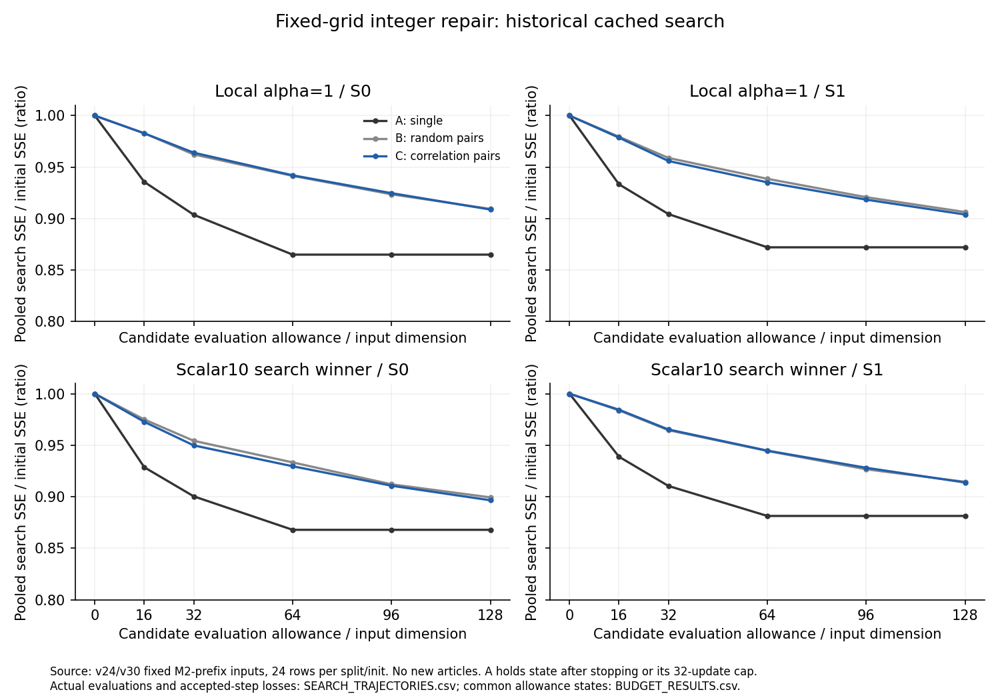
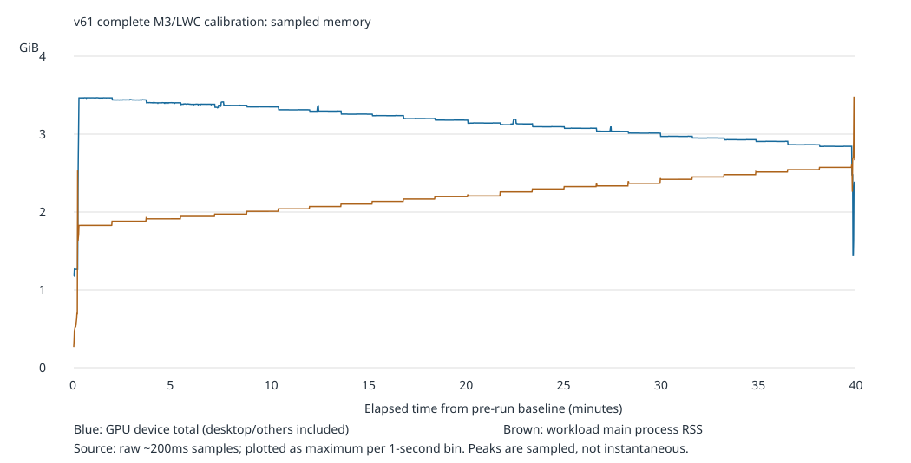

# Qwen2.5-0.5B 量化与整数码修复研究

本仓库的主线是对 `Qwen/Qwen2.5-0.5B-Instruct` 的后训练量化、固定网格搜索、整数码修复，以及质量与校准成本的对照分析。实验按版本保存冻结协议、来源审计、原始结果、失败记录和复现入口；结论以报告中实际完成的范围为准。

> **阅读入口：** [v1–v62 实验索引](docs/experiment_archive/EXPERIMENT_INDEX.csv) · [归档说明与复现指南](docs/experiment_archive/README.md) · [范围、排除项与证据限制](docs/experiment_archive/ARCHIVE_SCOPE.md)

## 研究主线

1. 建立 GPTQ 原生初始化与 scalar10 网格搜索对照。
2. 在固定量化网格上研究整数码局部修复，并逐步完善数值核验、packing/reload 和 decoder 前缀传播检查。
3. 在同一运行时内比较 M1、M2、M1＋修复与 M2＋修复，并整理仓库 M3/LWC 路线的质量与成本证据。

详细版本、实际执行状态和可用复现命令见[实验索引](docs/experiment_archive/EXPERIMENT_INDEX.csv)。根目录旧 `benchmark/` 不再属于本项目主线；其本地文件保留在原处，不纳入当前 Git 主线。

## 关键结果

v59 在同一 Python 进程中完成四个固定 checkpoint 的 WT2 test 和 C4 fixed-budget validation 评测。按 valid token 加权的 PPL 如下：

| 数据集 | M1 | M2 | M1＋修复 | M2＋修复 |
|---|---:|---:|---:|---:|
| WikiText-2 test | 13.8843 | 13.7608 | 13.6308 | **13.4993** |
| C4 fixed-budget validation | 22.2333 | 22.0325 | 22.1414 | **21.8946** |

v55 和 v56 各自包含独立传播验证。历史 v45/v46/v49 的校准传播证据仍为 `UNKNOWN`，不能用后来统一评测替代。v61 是新执行的仓库 M3/LWC 校准，不继承旧 M3 的 PPL；v62 在 WT2 上 v55 较低，在固定预算 C4 验证流上 v61 M3 较低，显示语料间取舍。



*图 1：v41 使用历史缓存输入的局部 search 损失轨迹，仅用于展示探索过程，不代表完整模型质量或新数据验证。*



*图 2：v61 完整 M3/LWC 校准的内存采样记录；设备总显存采样可能包含其他进程，不等于本进程独占显存。*

## 证据边界

- v59 的四臂主表是固定 checkpoint 的单次统一评测；不代表统计显著、跨 seed 稳定或新的盲测结果。
- v55/v56 的独立传播检查只支持各自报告覆盖的运行。历史 v45/v46/v49 继续标为 `UNKNOWN`。
- v62 比较的是仓库 M3/LWC 与 M2＋修复两套完整方案，量化格式与优化路线不同，不能把差异单独归因于某个组件。
- 整数坐标修复遵循已有离散修复思路，本项目不宣称该算法为原创，也不声称是官方 ReQuant 或 OmniQuant 完整复现。
- 校准/量化耗时不是在线推理加速；局部重构损失下降也不能替代完整模型 PPL。
- C4 指冻结的固定预算 validation 流，不称为标准 full C4。WT2 与 C4 都是长期使用的 benchmark，不是新盲测数据。

## 目录

- [`experiments/range_search_w4/`](experiments/range_search_w4/)：共享实现、协议及 v1–v60 的实验结果。
- [`results/v61_m3_calibration_cost_memory/`](results/v61_m3_calibration_cost_memory/)：新 M3/LWC 完整校准、耗时和内存测量。
- [`results/v62_m3_vs_repaired_quality_cost/`](results/v62_m3_vs_repaired_quality_cost/)：v61 M3 与 v55 修复模型的同进程质量/成本比较。
- [`docs/experiment_archive/`](docs/experiment_archive/)：版本索引、复现说明、本地大型产物清单和数据输入元信息。

## 从归档开始复现

先阅读目标版本的 `REPORT.md`、冻结协议和 `REPRODUCE.md`。不同历史运行的 Python、PyTorch、Transformers、CUDA、attention 和精度配置可能不同；仓库根目录依赖文件不是所有版本的统一环境锁。

CPU-only 的归档目录索引可在仓库根目录运行：

```powershell
python docs/experiment_archive/build_archive_catalog.py
```

该命令更新实验目录索引，默认保留大型产物清单，不读取 checkpoint 或缓存内容。量化、校准激活捕获、整数码修复和完整 PPL 评测需要对应协议指定的 GPU 环境，以及本机保留或按冻结来源重新获取的模型与数据。复现实验时使用新的输出目录，不覆盖历史结果。

大型 checkpoint、候选权重、激活/Hessian/Gram 缓存及完整语料不上传到 Git；路径、大小、用途和哈希来源见 [`LARGE_ARTIFACTS_MANIFEST.csv`](docs/experiment_archive/LARGE_ARTIFACTS_MANIFEST.csv)。没有已有哈希且未计算的项目标记为 `NOT_COMPUTED`。
