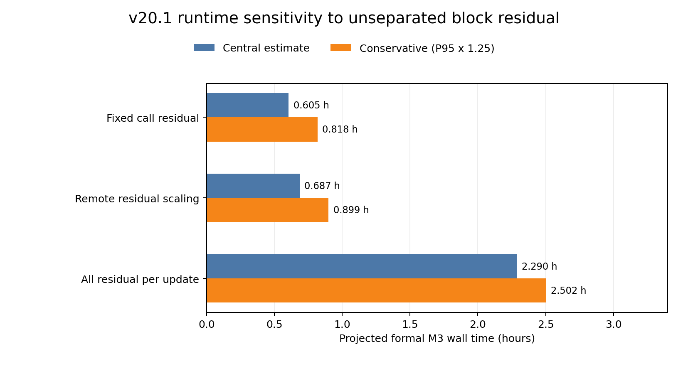

# v20.1-Kaggle：2048-token matched-shape preflight

## Verdict

**`M3_KAGGLE_FORMAL_EXECUTION_READY`** under the frozen 24-hour research gate. The independent audit reproduces the remote result and also tests a much larger allocation of the unseparated block residual: its conservative projection is **2.502 h**, below 24 h. This is readiness for a later formal calibration request; it is not a completed M3 run or a quality result.

No formal 20-epoch calibration, WT2 PPL, or C4 PPL was run. Stop here as required by the v20.1 protocol.

## Frozen protocol and remote run

- OmniQuant: `OpenGVLab/OmniQuant`, commit `feffe8ea87d80f7bb57b6e25e7cff9dc950fcc14`.
- Model: `Qwen/Qwen2.5-0.5B-Instruct`, revision `7ae557604adf67be50417f59c2c2f167def9a775`, FP16.
- Quantization: W4A16, G128, asymmetric affine `[0,15]`, LWC on, LET off, one GPU (`cuda:0`).
- Calibration: frozen 128 samples × 2048 tokens, seed `20261005`, manifest SHA-256 `664419273f63df3c0b0746b18bb66b593a5384bbe6ba8afcd6f4905c9479aae3`.
- Formal update count, recomputed from the shipped loop: 24 blocks × 20 epochs × 128 samples / batch 1 = **61,440 updates**. These updates were projected for cost only; none were run formally.
- Kaggle kernel v2 completed on two visible Tesla T4 GPUs (14.562 GiB each), using only `cuda:0`. The preflight process exited 0; the kernel log spans 115.1 seconds through notebook packaging.
- Bundle, official source tree, model revision and model-file locks passed. The v2 bundle differs from v1 only in `run_preflight.py` and its expected-hash manifest; no algorithm source changed.

Attempt 1 is retained under `kaggle_output/`: it exited before any optimizer step because the harness shadowed `importlib`. Attempt 2 fixed that harness import scope and is retained under `kaggle_output_v2/`. Both attempts were private.

## Correctness and 2048-token measurements

The calibration manifest and all 128 ordered sample hashes matched. Native and port quant-off outputs were bitwise equal at L0, L12 and L23. At the measured optimizer steps, LWC parameters existed, gradients were finite and nonzero, updates changed parameters, and reconstruction losses remained finite.

| Layer | Measured steps | Median step (s) | Mean step (s) | P95 step (s) | Peak allocated (GiB) | Peak reserved (GiB) | OOM |
|---:|---:|---:|---:|---:|---:|---:|:---:|
| L0 | 5 | 0.033752 | 0.033931 | 0.034735 | 1.464 | 1.564 | No |
| L12 | 3 | 0.033611 | 0.035569 | 0.039253 | 1.447 | 1.527 | No |
| L23 | 3 | 0.033621 | 0.033438 | 0.033680 | 1.447 | 1.527 | No |

L12 has the highest measured mean step time. Its P95 comes from only three measured observations, so it is an unstable tail estimate. The largest representative-layer peak reserved memory was 1.564 GiB, below the frozen 8 GiB gate. The separate L0 eight-step sequence had zero allocated-memory growth; reserved memory stayed near 1.55 GiB. No target run OOMed.

## Formal runtime and residual sensitivity

Measured step timing gives a central optimizer component of 2,108.19 s (0.586 h). The pooled measured P95 is 0.037420 s; applying the frozen ×1.25 step margin to 61,440 updates gives 2,873.86 s (0.798 h). Other measured non-block components total 59.68 s.

The remote report's central 0.687 h and conservative 0.899 h are exactly reproducible. Its remaining `other_block_overhead_seconds` is a whole-call residual: the timing harness runs the configured 20 outer epoch iterations but limits each call to 4–6 optimizer updates. The residual is not decomposed into one-time call setup, per-epoch loop cost, and per-update cost. The remote estimate scales it by `128 / observed_updates`; that assumption is not identified by these short calls. I retained the raw Kaggle report and bracketed this component independently:

| Residual treatment | Central total (h) | Conservative total (h) | Meaning |
|---|---:|---:|---|
| Fixed per-block-call floor | 0.605 | 0.818 | The observed residual is charged once per formal block call. |
| Remote report scaling | 0.687 | 0.899 | Reproduces the original sample-scaled residual estimate. |
| All residual charged per formal update | 2.290 | 2.502 | Stress case: charges the full measured residual at every formal update. |

The stress case remains below 24 h, so the frozen runtime gate passes despite the residual ambiguity. The totals include 59.68 s of other measured costs and do not charge the diagnostic full-model prefix capture. Dense-export cost uses an FP16 state copy/serialization/reload proxy; actual W4 dequantization and its peak memory were not measured. The proxy is not presented as a direct export measurement.

Kaggle did not expose a session wall-time budget. Therefore the separate session status remains **`KAGGLE_SINGLE_SESSION_REQUIRES_RESUME`**; retain block-level checkpoint/resume for a formal run. This is distinct from the 24-hour research gate.

## Limits and warnings

- L12/L23 were fed native FP16 full-model prefix activations from the frozen tokens. This does not test a formal run's sequentially quantized prefixes.
- Kernel logs contain the upstream message `auto_gptq is required for real quantization`. The fake-quant/LWC optimizer preflight passed, but an AutoGPTQ packed-real-quant path was not tested.
- The dense export numbers are an IO proxy and do not include actual W4-to-dense conversion or export-memory feasibility.
- Only three representative layers and 11 timing observations inform the runtime projection. No claim is made about M3 PPL, quality versus M2, or formal calibration completion.

## Artifacts and reproduction

- Immutable downloaded Kaggle files and kernel log: `kaggle_output_v2/`.
- Archive/member hashes and attempt provenance: `KAGGLE_OUTPUT_MANIFEST.json`, `KAGGLE_REMOTE_RUN.json`.
- Independent correctness and cost sensitivity recomputation: `COST_MODEL_AUDIT.json`, `FORMAL_M3_COST_BREAKDOWN_AUDITED.csv`.
- Original Kaggle-generated report and raw cost files: `kaggle_output_v2/range_w4_omniquant_kaggle_v20_1/REPORT.md` and adjacent JSON/CSV files.
- Re-run the local audit from this directory with `python -B audit_cost_model.py`.
- Frozen Kaggle bundle: `kaggle_bundle_v20_1_r2.zip`, SHA-256 `a39c94df22754e8f231e30cadbf579a091695e90bb52a069db42d2a8187de213`.

The next formal calibration is a separate v21 task. No formal training or PPL job was started here.
